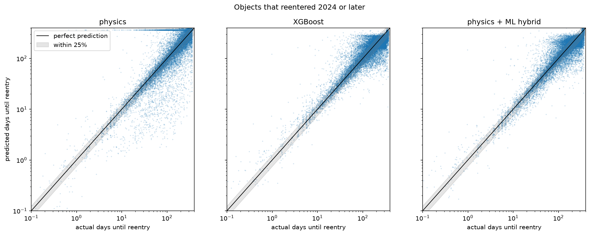

# Satellite Reentry Prediction

**Given an object's recent orbits and the space weather, how many days until it falls back into Earth's atmosphere?**

Reentry is hard to predict because the upper atmosphere keeps changing: when the Sun is active, it heats and expands the air, increasing drag on everything in low orbit. This project combines a **physics model of atmospheric drag**, derived from first principles and driven by the NRLMSIS 2.1 atmosphere, with **machine learning that learns to correct the physics**. It is trained on the final year of orbits of 17,558 objects that reentered since 2000 and tested on 4,897 objects that reentered from 2024 on.

## Results

On objects that reentered from 2024 onward, which no model saw during training (median error relative to the true time left; lower is better):

| Model | < 1 week | 1–4 weeks | 1–3 months | 3–12 months | Overall | Within 25% |
|---|---|---|---|---|---|---|
| Rule of thumb (current sinking rate continues) | 522% | 389% | 395% | 444% | 427% | 7% |
| Physics only (drag simulation, no training) | 22% | 17% | 21% | 25% | 24% | 52% |
| XGBoost (tuned) | 27% | **15%** | 19% | 19% | 19% | 63% |
| Gaussian process | 24% | 18% | 25% | 23% | 23% | 54% |
| **Physics + ML hybrid** | **21%** | 16% | **18%** | **16%** | **16%** | **67%** |



- **The hybrid is the most accurate model** overall and for every object type: 15% for debris and rocket bodies, 11% for ordinary satellites, 28% for Starlink (whose reentries are chosen by the operator).
- **The physics alone, with one fitted number per object and no training, is almost as good as XGBoost**, and better than it in the final week.
- **It holds across the solar cycle.** Retrained and tested year by year since 2005, the hybrid is best or tied in 20 of 22 years (median 22%, against 24% for XGBoost and 27% for physics). See [`results/backtest_by_year.png`](results/backtest_by_year.png).
- **Calibrated uncertainty.** Conformal prediction gives a 90% range around each prediction, recalibrated monthly on recent reentries; it contains the truth 89% of the time.
- **Against the official US Space Force predictions:** given equally fresh orbits, the physics model is 28% more accurate than the official forecasts from 4+ days out, and within 1.2× of them 2–4 days out; in the final day the official forecasts, with dense radar tracking, are far better. See [below](#against-the-official-predictions).

Every number comes from [`EXPERIMENTS.md`](EXPERIMENTS.md), a numbered log of 15 experiments, with every model setting chosen on a 2023 validation year rather than the test set.

## How it works

1. **Data.** [Space-Track.org](https://www.space-track.org) keeps every orbit ever published for every tracked object. `download_history.py` fetches the final 365 days of orbits for every object that reentered since 2000, and `build_reentry_dataset.py` turns them into one row per object per day, with sinking rates, solar flux (F10.7) and geomagnetic activity (Ap) known on that day, and the true days left.
2. **Physics** ([derivation](docs/derivation.md)). From the drag force, the orbit shrinks as da/dt = −B ρ √(μa), with extra terms for stretched orbits that make the apogee drop while the perigee holds. The air density ρ comes from NRLMSIS 2.1, pre-computed as a global average over altitude, solar flux, Ap and time of year. Each object's drag parameter B = C_D·A/m is fitted by least squares from how its orbit actually sank over the past 30 days. A vectorized RK4 integrator then simulates the orbit forward until it reenters.
3. **Hybrid.** XGBoost with shallow, regularized trees learns log(actual / physics), a correction factor, from the orbit, space weather, object type and the physics outputs. Where the physics can't answer (a satellite holding its altitude with thrusters), the ML takes over.
4. **Uncertainty.** Mondrian conformal prediction turns past errors into a 90% range for each band of predicted days and each object group.

The physics code is tested against exact answers: in an exponential atmosphere the lifetime has a closed form (using the Dawson function), and the simulation matches it to 0.2%.

## Scripts

| Script | What it does |
|---|---|
| [`src/lookup_satellite.py`](src/lookup_satellite.py) | Interactive lookup of any of the ~71,000 tracked objects, with a live reentry prediction for objects in low orbit |
| [`src/predict_reentry.py`](src/predict_reentry.py) | Predicts reentry for one object from its latest Space-Track orbits (used by the lookup) |
| [`src/spacetrack.py`](src/spacetrack.py) | Logs in to Space-Track and makes rate-limited queries |
| [`src/download_history.py`](src/download_history.py) | Downloads the final year of orbits for every reentry since 2000 |
| [`src/build_reentry_dataset.py`](src/build_reentry_dataset.py) | Builds the training table (3.7 million daily orbits) |
| [`src/atmosphere.py`](src/atmosphere.py) | Exponential and NRLMSIS 2.1 density models; builds the density table |
| [`src/orbit_decay.py`](src/orbit_decay.py) | Drag equations, orbit averaging and the RK4 propagator |
| [`src/physics_model.py`](src/physics_model.py) | Fits each object's drag parameter and simulates one orbit a week per object |
| [`src/train_reentry_model.py`](src/train_reentry_model.py) | Trains and compares all models on the test set |
| [`src/experiments.py`](src/experiments.py) | The validation-year experiments in `EXPERIMENTS.md` |
| [`src/uncertainty.py`](src/uncertainty.py) | Conformal 90% ranges, static and rolling |
| [`src/backtest.py`](src/backtest.py) | Year-by-year backtest since 2005 |
| [`src/download_tip.py`](src/download_tip.py), [`src/download_final_orbits.py`](src/download_final_orbits.py), [`src/compare_official.py`](src/compare_official.py) | Comparison with the official reentry predictions |
| [`src/analyze_errors.py`](src/analyze_errors.py) | Breaks down where the first XGBoost model went wrong |
| [`src/explore_data.py`](src/explore_data.py) | Exploratory analysis of the satellite catalog and space weather |
| [`src/collect_snapshots.py`](src/collect_snapshots.py) | Optional daily collector of current orbits from CelesTrak |

## Quick start

Tested with Python 3.15.

```bash
git clone https://github.com/yatharthjag2008/Satellite_Reentry_Prediction.git
cd Satellite_Reentry_Prediction

python -m venv .venv
.venv\Scripts\activate          # Windows
# source .venv/bin/activate     # macOS / Linux

pip install -r requirements.txt
python -m pytest                # 35 tests, including the physics checks
```

The catalog and space weather are included in `data/`, so the lookup works right away:

```bash
python src/lookup_satellite.py
```

Type a full or partial name (`ISS (ZARYA)`, `HST`, `starlink`) or a NORAD ID (`25544`). For an object still in low orbit it asks whether to predict its reentry, which needs the Space-Track login and trained models below.

### Reproducing the models

Space-Track's terms don't allow republishing its data, so the downloaded orbits (`data/spacetrack/`) and trained models (`models/`) are not in this repo. Create a free [Space-Track account](https://www.space-track.org/auth/createAccount) and put your login in a `.env` file in the project folder:

```
SPACETRACK_USER=you@example.com
SPACETRACK_PASSWORD=your-password
```

Then run, in order:

```bash
python src/download_history.py        # about a day, because of Space-Track's rate limits
python src/build_reentry_dataset.py   # under a minute
python src/atmosphere.py              # NRLMSIS density table, about 4 minutes
python src/physics_model.py           # about 7 minutes
python src/train_reentry_model.py     # about 3 minutes
python src/uncertainty.py             # ranges used by the lookup
```

## Against the official predictions

The US Space Force issues Tracking and Impact Prediction (TIP) messages for objects in their final days. For about 10,000 messages on about 1,900 objects that reentered from 2024 on, our models predicted from our latest orbit at the moment each message was issued. Median error of the predicted reentry time:

| Made before reentry | Official | Physics, one orbit a day | Physics, fresh orbits, 8-day drag fit |
|---|---|---|---|
| Under 1 day | **0.7 h** | 4.1 h | 1.6 h |
| 1–2 days | **3.7 h** | 9.0 h | 6.4 h |
| 2–4 days | **7.8 h** | 13.6 h | 9.5 h |
| 4+ days | 37.1 h | 37.3 h | **26.7 h** |

With one orbit a day (the training table), our latest orbit is 8–12 hours old. With every orbit it's under 2 hours old, and close to reentry the orbit sinks fast enough to measure the drag over just the last 8 days, which captures recent changes such as tumbling. The live lookup uses that method within 10 days of reentry. See experiments 011 and 015 in [`EXPERIMENTS.md`](EXPERIMENTS.md).

## Data

| Source | Contents |
|---|---|
| [Space-Track.org](https://www.space-track.org) (not redistributed) | Orbit history of every reentered object, official TIP reentry predictions |
| [CelesTrak SATCAT](https://celestrak.org/pub/satcat.csv) → `data/satcat.csv` | Every tracked object: launch and decay dates, orbit, radar size, type and owner |
| [CelesTrak space weather](https://celestrak.org/SpaceData/SW-All.csv) → `data/SW-All.csv` | Daily F10.7 solar flux and Ap/Kp geomagnetic indices since 1957 |
| [NRLMSIS 2.1](https://github.com/SWxTREC/pymsis) via `pymsis` | Empirical model of upper-atmosphere density |

## Earlier findings (catalog only)

Before the Space-Track data, `explore_data.py` looked at the catalog alone. Its orbit values are mostly the *final* orbit before reentry (65% of reentered objects have a catalog perigee under 250 km), so catalog altitude barely correlates with lifetime (r = 0.11). That's why the models above use dated orbit histories instead.

## Roadmap

- [x] Days until reentry from orbit histories: rule of thumb, linear, XGBoost, Gaussian process
- [x] Physics model: drag derivation, NRLMSIS density, fitted drag parameter, RK4 propagator
- [x] Physics + ML hybrid, tuned on a validation year
- [x] Year-by-year backtest across two solar cycles
- [x] Conformal 90% ranges with rolling recalibration
- [x] Comparison with the official US Space Force predictions
- [x] Live predictions in the lookup tool
- [ ] Lifetime from the first orbits after launch (Part 1)

## Project structure

```
Satellite_Reentry_Prediction/
├── data/                   catalog and space weather (Space-Track data stays local)
├── docs/derivation.md      the drag physics, from first principles
├── results/                error tables and plots
├── src/                    scripts listed above
├── tests/                  physics checks against exact answers, fitting, conformal
├── EXPERIMENTS.md          numbered experiment log
├── requirements.txt
└── README.md
```

## Acknowledgments

Orbit histories and official reentry predictions from [Space-Track.org](https://www.space-track.org) (US Space Force). Catalog and space weather data from [CelesTrak](https://celestrak.org), maintained by Dr. T.S. Kelso. Atmospheric density from NRLMSIS 2.1 (US Naval Research Laboratory) through [pymsis](https://github.com/SWxTREC/pymsis).
