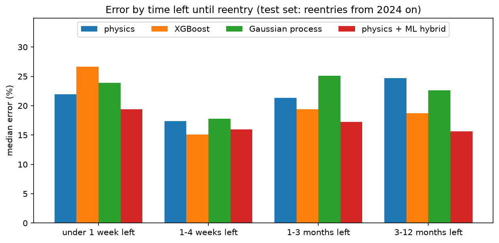
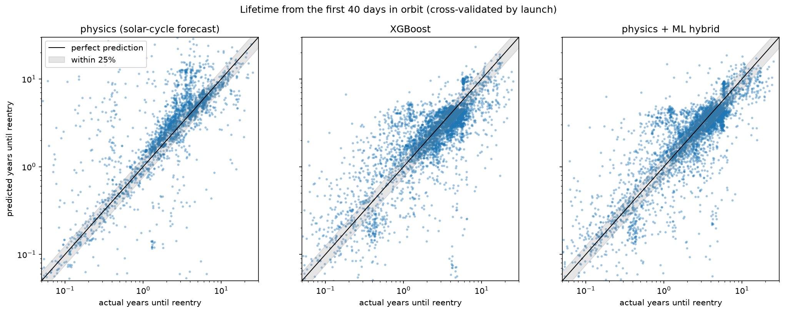

# Satellite Reentry Prediction

**🔗 Live site: [yatharthjag2008.github.io/Satellite_Reentry_Prediction](https://yatharthjag2008.github.io/Satellite_Reentry_Prediction/)**. Upcoming reentries forecast every 6 hours with a map of where they can come down and a running track record, a lookup of any of the ~71,000 tracked objects, and the results below.

[](https://github.com/yatharthjag2008/Satellite_Reentry_Prediction/actions/workflows/tests.yml)

**Given an object's recent orbits and the space weather, how many days until it falls back into Earth's atmosphere?**

Reentry is hard to predict because the upper atmosphere keeps changing: when the Sun is active, it heats and expands the air, increasing drag on everything in low orbit. This project combines a **physics model of atmospheric drag**, derived from first principles and driven by the NRLMSIS 2.1 atmosphere, with **machine learning that learns to correct the physics**. It is trained on the final year of orbits of 17,558 objects that reentered since 2000 and tested on 4,897 objects that reentered from 2024 on. A short paper-style write-up is in [`docs/writeup.md`](docs/writeup.md).

## Results

On objects that reentered from 2024 onward, which no model saw during training (median error relative to the true time left; lower is better):

| Model | < 1 week | 1–4 weeks | 1–3 months | 3–12 months | Overall | Within 25% |
|---|---|---|---|---|---|---|
| Rule of thumb (current sinking rate continues) | 522% | 389% | 395% | 444% | 427% | 7% |
| Physics only (drag simulation, no training) | 22% | 17% | 21% | 25% | 24% | 52% |
| XGBoost (tuned) | 27% | **15%** | 19% | 19% | 19% | 63% |
| Gaussian process | 24% | 18% | 25% | 23% | 23% | 54% |
| **Physics + ML hybrid** | **19%** | **15%** | **18%** | **16%** | **16%** | **68%** |




- **The hybrid is the most accurate model** overall and for every object type: 15% for debris and rocket bodies, 11% for ordinary satellites, 28% for Starlink (whose reentries are chosen by the operator).
- **The physics alone, with one fitted number per object and no training, is almost as good as XGBoost**, and better than it in the final week.
- **It holds across the solar cycle.** Retrained and tested year by year since 2005, the hybrid is best or tied in 20 of 22 years (median 22%, against 24% for XGBoost and 27% for physics). See [`results/backtest_by_year.png`](results/backtest_by_year.png).
- **Calibrated uncertainty.** Conformal prediction gives a 90% range around each prediction, recalibrated monthly on recent reentries; it contains the truth 89% of the time. In the final days, ranges calibrated on every orbit held for 87–95% of later reentries (experiment 023).
- **Against the official US Space Force predictions:** given equally fresh orbits, the physics model is 28% more accurate than the official forecasts from 4+ days out, and within 1.2× of them 2–4 days out; in the final day the official forecasts, with dense radar tracking, are far better. See [below](#against-the-official-predictions).
- **The physics knows when it's wrong.** A fitted drag parameter above 1 m²/kg is more than any solid object has, so the orbit is being moved by something else (gravity on a stretched orbit, or thrusters); the physics then gives no answer and the hybrid takes over (experiments 021–022).

Every number comes from [`EXPERIMENTS.md`](EXPERIMENTS.md), a numbered log of 25 experiments, with every model setting chosen on a 2023 validation year rather than the test set.

### Whole lifetimes from the first month (Part 1)

From only an object's orbits 10–40 days after launch, the physics model with a solar-cycle forecast predicts how long it will stay up, often years ahead. For transfer orbits it also includes the Moon's and Sun's gravity (below). On 2,982 satellites and rocket bodies launched since 2000:

| Future solar flux | 1–3 years left | 3–10 years left | Overall |
|---|---|---|---|
| Today's held fixed | 49% | 232% | 69% |
| **Solar-cycle forecast** | 30% | **19%** | **26%** |
| Perfect forecast (upper bound) | 16% | 19% | 19% |

Near-circular satellites come out at about 25%, near-circular rocket bodies at about 21% and rocket bodies in transfer orbits at 29%. Tested on launches from a later period (2012–2015), the physics held up (23% for satellites), while ML models trained on earlier launches did not (experiment 019). It doesn't work for Starlink, whose lifetime is set by the operator.

**Transfer orbits.** Rocket bodies left in stretched orbits toward geostationary altitude are moved by the Moon's and Sun's gravity, which slowly raises or lowers their perigee, so drag alone mostly predicts they never come down (median error 503% on 261 of them). With the Sun's and Moon's tides and Earth's flattening added ([`lunisolar.py`](src/lunisolar.py), [derivation](docs/derivation.md#9-the-moon-the-sun-and-earths-flattening)), the median error is **28%**, as good as for ordinary orbits, and 97% get an answer instead of 66% (experiment 025). Part 1 now uses this for every transfer orbit.



## Live forecasts

Every 6 hours, [`forecasts.yml`](.github/workflows/forecasts.yml) runs [`live_forecasts.py`](src/live_forecasts.py) on GitHub Actions and publishes the results to the [website](https://yatharthjag2008.github.io/Satellite_Reentry_Prediction/#forecasts):

1. **Collect.** CelesTrak's decaying objects every run, and once a day the larger low-orbit groups (below 500 km), the catalog and the space weather. The orbits come from Space-Track through CelesTrak, so they stay in the repository's Actions cache and are never published.
2. **Forecast.** The physics model, run as in the lookup tool: B fitted over up to 30 days of one orbit a day, or over the last 8 days within 10 days of reentry. Objects tracked for less than a month get a fit over the days there are and a 90% range calibrated for that ([`forecast_ranges.py`](src/forecast_ranges.py)). No forecast is made for an object holding its altitude, or one whose fitted B is too large to be drag.
3. **Map.** For each object whose 90% window is under 2 days, the ground track during the window, which is where it can come down ([`ground_track.py`](src/ground_track.py), using SGP4). With a wider window, the answer is the band of latitudes its orbit covers.
4. **Score.** Every forecast is logged, and once the catalog lists the object as reentered, compared with the decay date.

The forecasts, the tracks, the log and the scores are on the [`forecast-data`](https://github.com/yatharthjag2008/Satellite_Reentry_Prediction/tree/forecast-data) branch. Unlike everything above, these are made before the answer is known; the track record started on 27 November 2026. They use the physics model only: the hybrid was trained on Space-Track data and stays private. Replayed on 809 past reentries, the same pipeline had a median error of 20%, with 96% of its 90% ranges containing the truth.

## How it works

1. **Data.** [Space-Track.org](https://www.space-track.org) keeps every orbit ever published for every tracked object. `download_history.py` fetches the final 365 days of orbits for every object that reentered since 2000, and `build_reentry_dataset.py` turns them into one row per object per day, with sinking rates, solar flux (F10.7) and geomagnetic activity (Ap) known on that day, and the true days left.
2. **Physics** ([derivation](docs/derivation.md)). From the drag force, the orbit shrinks as da/dt = −B ρ √(μa), with extra terms for stretched orbits that make the apogee drop while the perigee holds. The air density ρ comes from NRLMSIS 2.1, pre-computed as a global average over altitude, solar flux, Ap and time of year. Each object's drag parameter B = C_D·A/m is fitted by least squares from how its orbit actually sank over the past 30 days; a negative B (the orbit rose) or one over 1 m²/kg (not drag) gets no prediction. A vectorized RK4 integrator then simulates the orbit forward until it reenters. For stretched orbits, [`lunisolar.py`](src/lunisolar.py) adds the Sun's and Moon's gravity and Earth's flattening.
3. **Hybrid.** XGBoost with shallow, regularized trees learns log(actual / physics), a correction factor, from the orbit, space weather, object type and the physics outputs. Where the physics can't answer (a satellite holding its altitude with thrusters), the ML takes over.
4. **Uncertainty.** Mondrian conformal prediction turns past errors into a 90% range for each band of predicted days and each object group.

The physics code is tested against exact answers: in an exponential atmosphere the lifetime has a closed form (using the Dawson function), and the simulation matches it to 0.2%; the Earth-flattening precession matches the textbook rates to 0.1%; and a geostationary orbit's ground track stays over one longitude.

## Scripts

| Script | What it does |
|---|---|
| [`src/lookup_satellite.py`](src/lookup_satellite.py) | Interactive lookup of any of the ~71,000 tracked objects, with a live reentry prediction for objects in low orbit |
| [`src/predict_reentry.py`](src/predict_reentry.py) | Predicts reentry for one object from its latest Space-Track orbits (used by the lookup) |
| [`src/spacetrack.py`](src/spacetrack.py) | Logs in to Space-Track and makes rate-limited queries |
| [`src/download_history.py`](src/download_history.py) | Downloads the final year of orbits for every reentry since 2000 |
| [`src/build_reentry_dataset.py`](src/build_reentry_dataset.py) | Builds the training table (3.7 million daily orbits) |
| [`src/atmosphere.py`](src/atmosphere.py) | Exponential and NRLMSIS 2.1 density models; builds the density table |
| [`src/orbit_decay.py`](src/orbit_decay.py) | Drag equations, orbit averaging and the RK4 propagator |
| [`src/physics_model.py`](src/physics_model.py) | Fits each object's drag parameter and simulates one orbit a week per object |
| [`src/train_reentry_model.py`](src/train_reentry_model.py) | Trains and compares all models on the test set |
| [`src/experiments.py`](src/experiments.py) | The experiments in `EXPERIMENTS.md` |
| [`src/uncertainty.py`](src/uncertainty.py) | Conformal 90% ranges for the hybrid, static and rolling |
| [`src/forecast_ranges.py`](src/forecast_ranges.py) | Conformal 90% ranges for the physics: the live forecasts' and the lookup's in the final days |
| [`src/backtest.py`](src/backtest.py) | Year-by-year backtest since 2005 |
| [`src/download_tip.py`](src/download_tip.py), [`src/download_final_orbits.py`](src/download_final_orbits.py), [`src/compare_official.py`](src/compare_official.py) | Comparison with the official reentry predictions |
| [`src/solar_cycle.py`](src/solar_cycle.py) | Forecasts solar flux years ahead from the shape of past cycles |
| [`src/download_early_orbits.py`](src/download_early_orbits.py), [`src/lifetime_model.py`](src/lifetime_model.py), [`src/train_lifetime_model.py`](src/train_lifetime_model.py) | Part 1: whole lifetimes from the first 40 days in orbit |
| [`src/lunisolar.py`](src/lunisolar.py), [`src/download_transfer_orbits.py`](src/download_transfer_orbits.py) | The Sun's and Moon's gravity and Earth's flattening, for transfer orbits in Part 1 |
| [`src/live_forecasts.py`](src/live_forecasts.py) | The website's live forecasts: collects CelesTrak orbits, forecasts every tracked object, maps imminent reentries and scores past forecasts (run by GitHub Actions) |
| [`src/ground_track.py`](src/ground_track.py) | Where an object can come down: its ground track during the reentry window, from SGP4 |
| [`src/build_site.py`](src/build_site.py) | Builds the website from `site/`, the CelesTrak data, the plots and the live forecasts; GitHub Actions publishes it |
| [`src/analyze_errors.py`](src/analyze_errors.py) | Breaks down where the first XGBoost model went wrong |
| [`src/explore_data.py`](src/explore_data.py) | Exploratory analysis of the satellite catalog and space weather |
| [`src/collect_snapshots.py`](src/collect_snapshots.py) | Optional daily collector of current orbits from CelesTrak |

## Quick start

Tested with Python 3.15.

```bash
git clone https://github.com/yatharthjag2008/Satellite_Reentry_Prediction.git
cd Satellite_Reentry_Prediction

python -m venv .venv
.venv\Scripts\activate          # Windows
# source .venv/bin/activate     # macOS / Linux

pip install -r requirements.txt
python src/atmosphere.py        # NRLMSIS density table, about 4 minutes
python -m pytest                # 70 tests, including the physics checks
```

The catalog and space weather are included in `data/`, so the lookup works right away:

```bash
python src/lookup_satellite.py
```

Type a full or partial name (`ISS (ZARYA)`, `HST`, `starlink`) or a NORAD ID (`25544`). For an object still in low orbit it asks whether to predict its reentry, which needs the Space-Track login and trained models below. It picks the method that tested best for how far away reentry is:

- **within about 10 days:** the physics model with drag measured over the last 8 days of tracking, with a 90% range
- **10 days to 2 years:** the physics + ML hybrid, with a 90% range
- **further out:** the physics model with a forecast of the Sun's 11-year cycle

```
 REENTRY PREDICTION
 Latest orbit 2026-11-15 12:02 UTC: 238 x 247 km
 Physics model: about 9 days (around 2026-11-24)
 (drag measured over the last 8 days of tracking: our most accurate
  method this close to reentry; the official forecasts are better in the final day)
 90% range:     2026-11-22 to 2026-11-27
 Where: anywhere between 52°S and 52°N, the latitudes its orbit passes over
```

### Reproducing the models

Space-Track's terms don't allow republishing its data, so the downloaded orbits (`data/spacetrack/`) and trained models (`models/`) are not in this repo. Create a free [Space-Track account](https://www.space-track.org/auth/createAccount) and put your login in a `.env` file in the project folder:

```
SPACETRACK_USER=you@example.com
SPACETRACK_PASSWORD=your-password
```

Then run, in order:

```bash
python src/download_history.py        # about a day, because of Space-Track's rate limits
python src/build_reentry_dataset.py   # under a minute
python src/atmosphere.py              # NRLMSIS density table, about 4 minutes
python src/physics_model.py           # about 9 minutes
python src/train_reentry_model.py     # about 3 minutes
python src/uncertainty.py             # the hybrid's ranges, used by the lookup
python src/backtest.py                # year by year since 2005

python src/download_tip.py            # official predictions
python src/download_final_orbits.py   # every orbit of the final 40 days
python src/compare_official.py --fresh
python src/forecast_ranges.py         # the physics ranges, used by the lookup and the live forecasts

python src/download_early_orbits.py   # Part 1: about an hour
python src/lifetime_model.py          # drag only for now: under a minute
python src/download_transfer_orbits.py # the angles of the transfer orbits
python src/lifetime_model.py          # again, with the Sun and Moon for transfer orbits: about 10 minutes
python src/train_lifetime_model.py
python src/experiments.py transfer_orbits
```

## Against the official predictions

The US Space Force issues Tracking and Impact Prediction (TIP) messages for objects in their final days. For about 10,000 messages on about 1,900 objects that reentered from 2024 on, our models predicted from our latest orbit at the moment each message was issued. Median error of the predicted reentry time:

| Made before reentry | Official | Physics, one orbit a day | Physics, fresh orbits, 8-day drag fit |
|---|---|---|---|
| Under 1 day | **0.7 h** | 4.1 h | 1.6 h |
| 1–2 days | **3.7 h** | 9.0 h | 6.4 h |
| 2–4 days | **7.8 h** | 13.6 h | 9.5 h |
| 4+ days | 37.1 h | 37.3 h | **26.7 h** |

With one orbit a day (the training table), our latest orbit is 8–12 hours old. With every orbit it's under 2 hours old, and close to reentry the orbit sinks fast enough to measure the drag over just the last 8 days, which captures recent changes such as tumbling. The lookup uses that method within 10 days of reentry. Even a perfect forecast of geomagnetic storms would improve it by only about an hour (experiment 024). See experiments 011, 015 and 023 in [`EXPERIMENTS.md`](EXPERIMENTS.md).

## Data

| Source | Contents |
|---|---|
| [Space-Track.org](https://www.space-track.org) (not redistributed) | Orbit history of every reentered object, official TIP reentry predictions |
| [CelesTrak current orbits](https://celestrak.org/NORAD/elements/) (not redistributed) | The latest orbits behind the live forecasts |
| [CelesTrak SATCAT](https://celestrak.org/pub/satcat.csv) → `data/satcat.csv` | Every tracked object: launch and decay dates, orbit, radar size, type and owner |
| [CelesTrak space weather](https://celestrak.org/SpaceData/SW-All.csv) → `data/SW-All.csv` | Daily F10.7 solar flux and Ap/Kp geomagnetic indices since 1957 |
| [NRLMSIS 2.1](https://github.com/SWxTREC/pymsis) via `pymsis` | Empirical model of upper-atmosphere density |
| [Natural Earth](https://www.naturalearthdata.com) 1:110m land → `site/land.json` | The website's map outline (public domain) |

## Earlier findings (catalog only)

Before the Space-Track data, `explore_data.py` looked at the catalog alone. Its orbit values are mostly the *final* orbit before reentry (65% of reentered objects have a catalog perigee under 250 km), so catalog altitude barely correlates with lifetime (r = 0.11). That's why the models above use dated orbit histories instead.

## Roadmap

- [x] Days until reentry from orbit histories: rule of thumb, linear, XGBoost, Gaussian process
- [x] Physics model: drag derivation, NRLMSIS density, fitted drag parameter, RK4 propagator
- [x] Physics + ML hybrid, tuned on a validation year
- [x] Year-by-year backtest across two solar cycles
- [x] Conformal 90% ranges with rolling recalibration, and for the final days using every orbit
- [x] Comparison with the official US Space Force predictions
- [x] Live predictions in the lookup tool
- [x] Whole lifetime from the first 40 days after launch, with a solar-cycle forecast (Part 1)
- [x] Live physics forecasts on the website every 6 hours, scored as the objects reenter
- [x] A map of where imminent reentries can come down
- [x] Lunisolar perturbations and Earth's flattening for transfer orbits
- [ ] Score the live forecasts over several months and compare them with the official predictions for the same objects

## Project structure

```
Satellite_Reentry_Prediction/
├── .github/workflows/      tests, the website, and the live forecasts every 6 hours
├── data/                   catalog and space weather (Space-Track data stays local)
├── docs/derivation.md      the physics, from first principles
├── docs/writeup.md         a short paper-style write-up of the project
├── results/                error tables, plots and calibrated range widths
├── site/                   the website's page, styles, search and map code
├── src/                    scripts listed above
├── tests/                  physics checks against exact answers, fitting, conformal, live forecasts
├── EXPERIMENTS.md          numbered experiment log
├── requirements.txt
└── README.md
```

The `forecast-data` branch holds the live forecasts, written by GitHub Actions.

## Acknowledgments

Orbit histories and official reentry predictions from [Space-Track.org](https://www.space-track.org) (US Space Force). Catalog, space weather and current orbits from [CelesTrak](https://celestrak.org), maintained by Dr. T.S. Kelso. Atmospheric density from NRLMSIS 2.1 (US Naval Research Laboratory) through [pymsis](https://github.com/SWxTREC/pymsis). Ground tracks with [sgp4](https://pypi.org/project/sgp4/) by Brandon Rhodes. Map outline from [Natural Earth](https://www.naturalearthdata.com).
